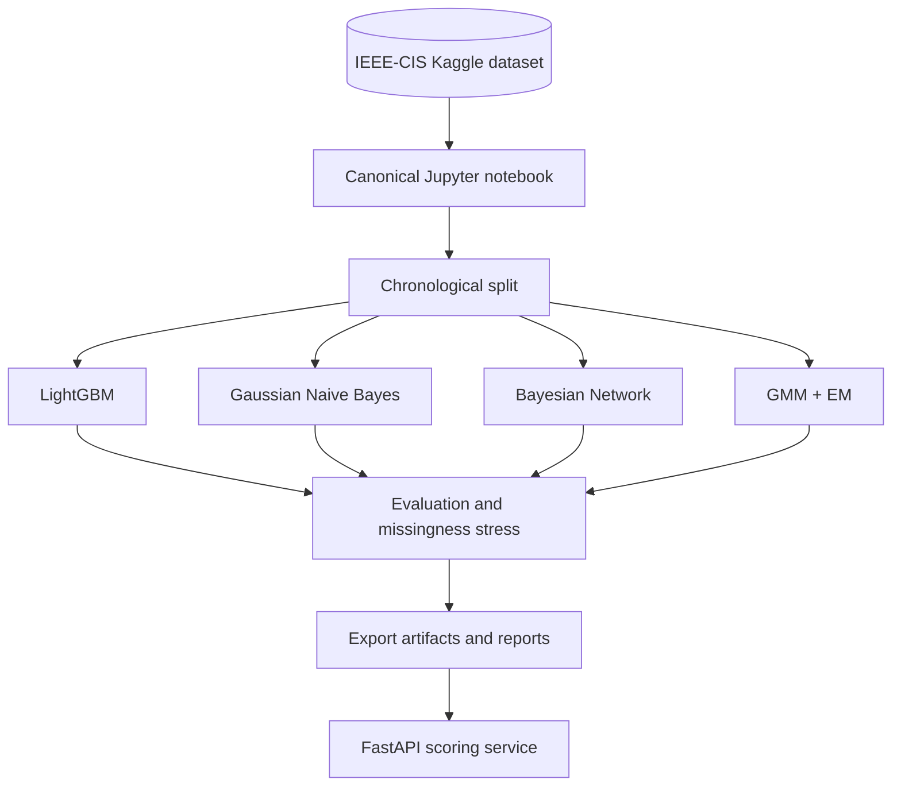

# FraudGuard

**A coursework-aligned fraud detection research prototype** using IEEE-CIS transactions to study probabilistic reasoning, Bayesian Networks, Gaussian Mixture Models (GMM), Expectation-Maximization (EM), and strong supervised baselines.

> [!IMPORTANT]
> The canonical training pipeline is [`fraudguard_training.ipynb`](fraudguard_training.ipynb). Training scripts from the previous parallel pipeline were removed to avoid duplicated and inconsistent results. The local IEEE-CIS files are kept for permitted local execution; do not redistribute them.

## What it does

- Joins IEEE-CIS transaction and identity tables on `TransactionID`.
- Uses a chronological split based on `TransactionDT`.
- Benchmarks LightGBM and Gaussian Naive Bayes.
- Evaluates a discrete Bayesian Network with missing evidence marginalized at inference.
- Fits a Gaussian Mixture Model using EM on legitimate transactions and uses negative log-likelihood as an anomaly score.
- Tests performance under controlled masking of identity/contact fields.
- Exports models, metrics, and metadata for reproducibility.
- Provides a FastAPI endpoint for the exported LightGBM model.
- Provides a lightweight Streamlit dashboard for interactive scoring.

## Workflow



## Repository structure

```text
fraudguard/
├── fraudguard_training.ipynb           # single source of truth for training
├── src/fraudguard/service/
│   └── app.py                   # serves exported LightGBM artifact
├── frontend/
│   ├── app.py                  # Streamlit scoring dashboard
│   └── requirements.txt
├── artifacts/                   # exported models and metadata
├── docs/
│   ├── PRD.md
│   ├── ARCHITECTURE.md
│   ├── SETUP.md
│   ├── EVALUATION.md
│   └── SECURITY.md
├── scripts/validate_training.py  # validates the training notebook
├── tests/test_api.py             # API readiness/authentication tests
├── Dockerfile
├── docker-compose.yml
└── Makefile
```

## Quick start

### 1. Train on Kaggle

1. Open a Kaggle notebook and attach **IEEE-CIS Fraud Detection**.
2. Run [`fraudguard_training.ipynb`](fraudguard_training.ipynb) from top to bottom.
3. Download `fraudguard_artifacts.zip` from `/kaggle/working/`.
4. Extract the generated files into this repository's `artifacts/` directory.

See [Setup](docs/SETUP.md) for details.

### 2. Run checks

```bash
python scripts/validate_training.py
pytest
```

### 3. Run the API

Copy `.env.example` to `.env`, set a strong API key, and run:

```bash
docker compose up --build
```

Open the dashboard at <http://localhost:8501>. It connects to the API through
the internal Compose network and uses the same `FRAUDGUARD_API_KEY`.

To run the dashboard without Docker, install `frontend/requirements.txt`, start
the API on port 8000, and run:

```bash
streamlit run frontend/app.py
```

Example request:

```bash
curl -X POST http://localhost:8000/v1/score \
  -H 'Content-Type: application/json' \
  -H 'X-API-Key: YOUR_API_KEY' \
  -d '{"features":{"TransactionAmt":125.5,"ProductCD":"W","TransactionDT":86400}}'
```

The feature dictionary should use the feature names from the IEEE-CIS training schema. Unspecified fields are treated as missing; unknown categorical values map to `__UNKNOWN__`.

## Current limitations

- The notebook's BN uses a manually specified graph and complete-case CPD fitting; missing evidence is marginalized at inference, but BN EM training is not implemented.
- GMM+EM is an unsupervised anomaly baseline, not a calibrated fraud probability.
- The API currently serves LightGBM only; BN/GMM are research comparisons.
- A notebook run is required before deployment artifacts exist.
- This is a research/educational prototype, not a production-certified fraud prevention service.

## Documentation

- [Product requirements](docs/PRD.md)
- [Architecture](docs/ARCHITECTURE.md)
- [Setup](docs/SETUP.md)
- [Evaluation protocol](docs/EVALUATION.md)
- [Security](docs/SECURITY.md)

## License

MIT for project code. IEEE-CIS dataset access and use are governed by the Kaggle competition's terms; dataset files are not redistributed here.
