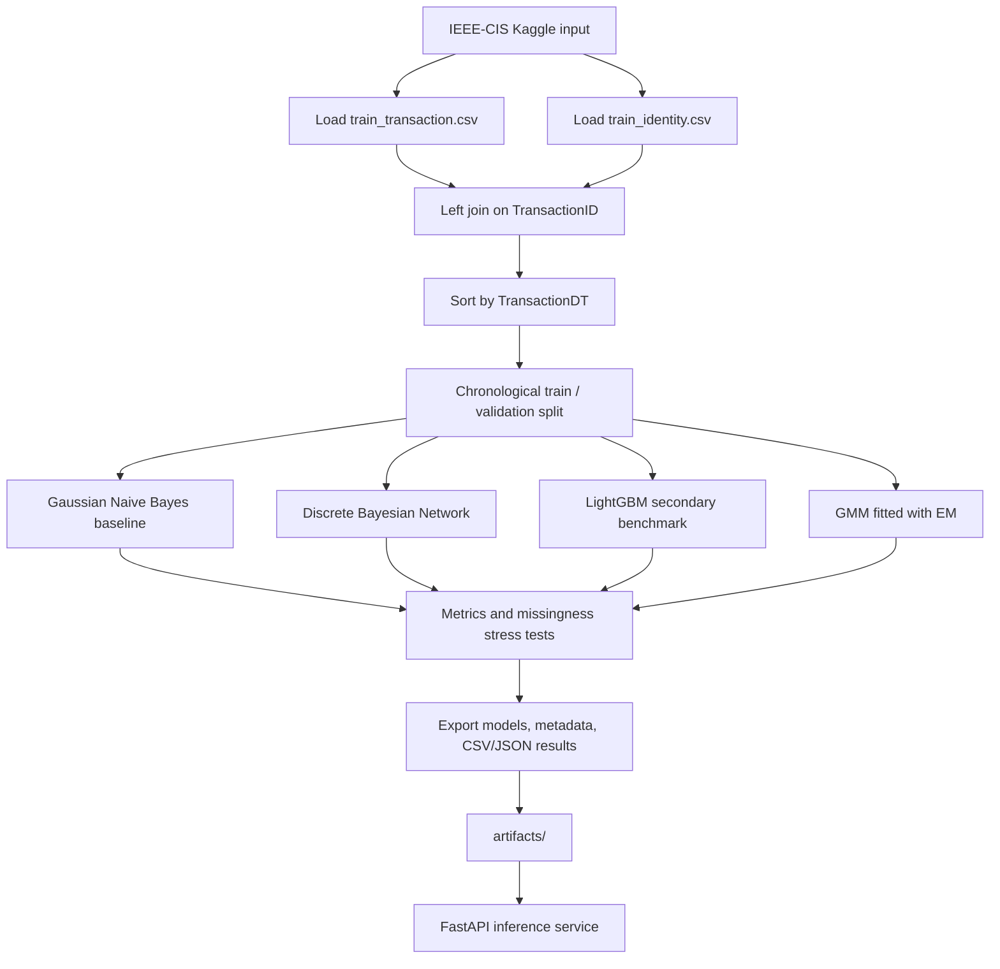
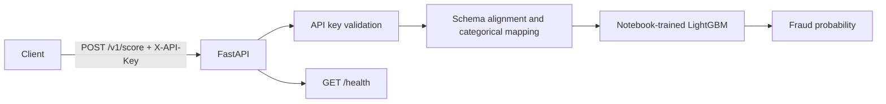

# Architecture

## Canonical workflow

## Deployment flow

## Important boundaries
- The notebook is the only training entry point. Legacy training scripts were removed to avoid pipeline drift.
- The academic progression is Gaussian Naive Bayes -> Bayesian Network. LightGBM is a secondary benchmark; the serving API currently serves LightGBM only.
- Missing BN evidence is marginalized at inference, but CPDs are estimated on complete cases; this is not EM training for the BN.
- GMM negative log likelihood is an anomaly score, not a calibrated fraud probability.

## Bayesian Network DAG

The notebook specifies these edges manually:

- `TransactionAmtBin -> Fraud`
- `TransactionDTBin -> Fraud`
- `card1Bin -> Fraud`
- `ProductCD -> Fraud`
- `card4 -> Fraud`
- `DeviceType -> Fraud`
- `P_emaildomain -> Fraud`
- `addr1Bin -> Fraud`
- `ProductCD -> addr1Bin`

CPDs use `BayesianEstimator` with a BDeu prior and equivalent sample size 10.
`VariableElimination` answers posterior queries for `Fraud`.
