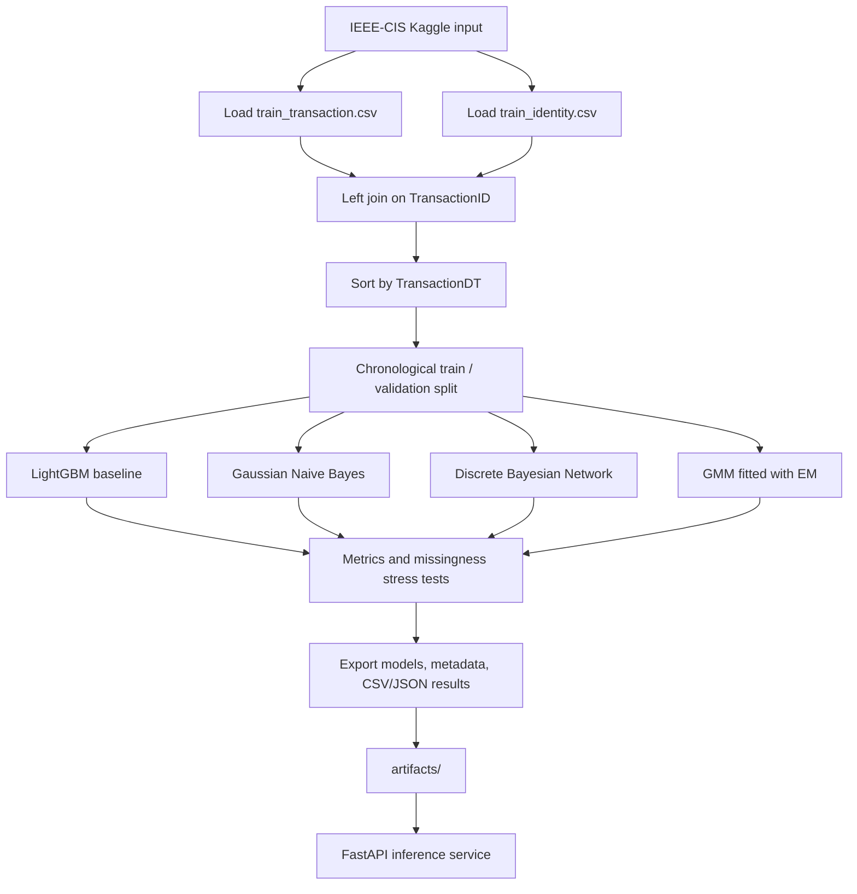
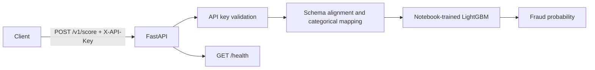

# Architecture

## Canonical workflow

## Deployment flow

## Important boundaries
- The notebook is the only training entry point. Legacy training scripts were removed to avoid pipeline drift.
- The Bayesian Network and GMM are research comparisons. The serving API currently serves LightGBM only.
- Missing BN evidence is marginalized at inference, but CPDs are estimated on complete cases; this is not EM training for the BN.
- GMM negative log likelihood is an anomaly score, not a calibrated fraud probability.
